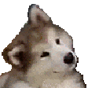
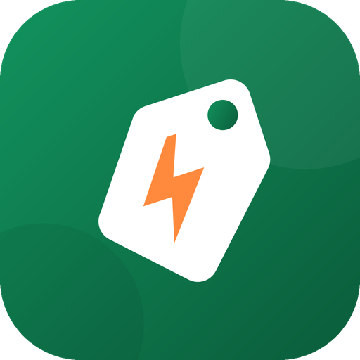
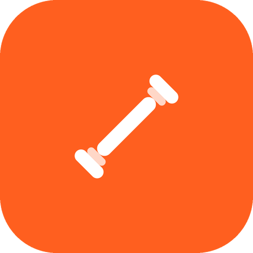
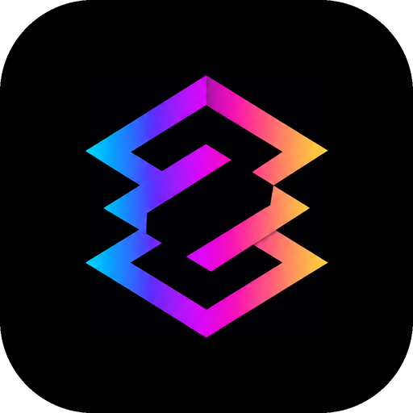
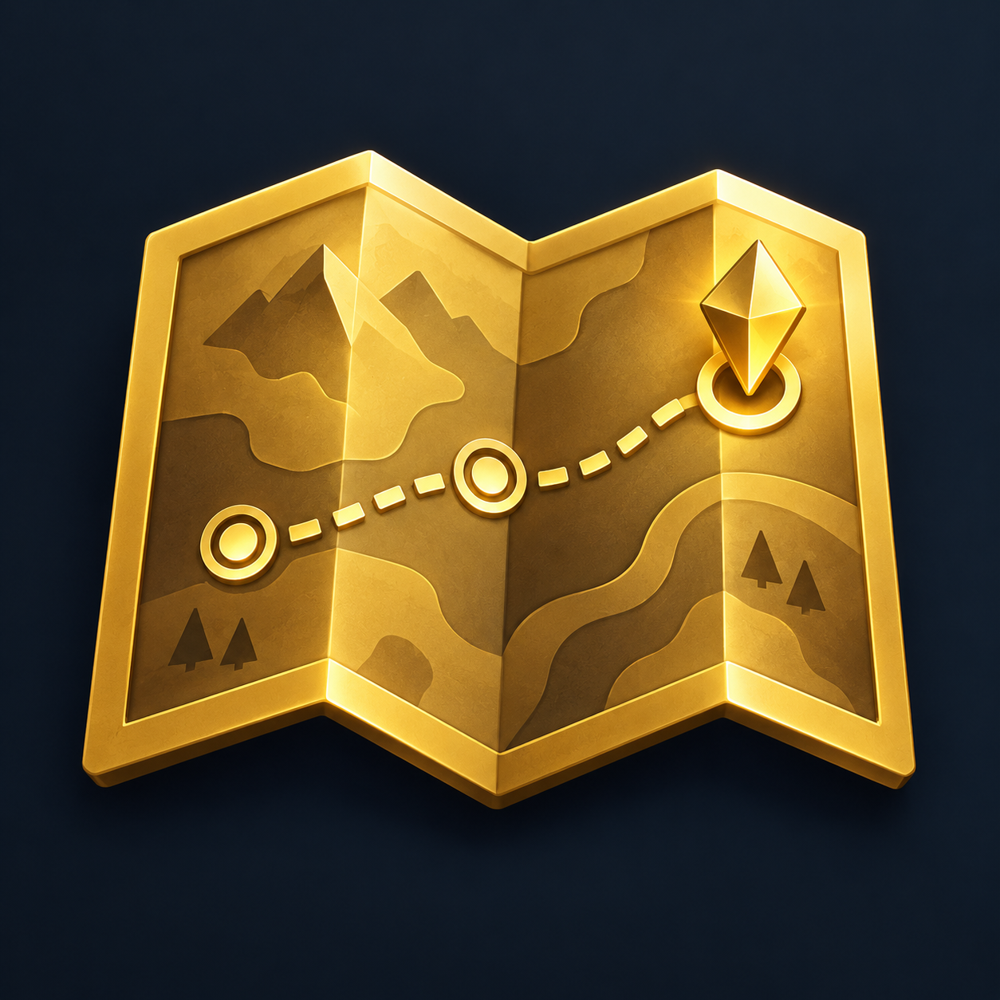

<h3>Hi </h3>

 

## 📱 On the stores

<table>
  <tr>
    <td width="33%" align="center" valign="top">
       
      
      <h3>Snaai</h3>
      
Every free giveaway near you in one feed.

       
      
    </td>
    <td width="33%" align="center" valign="top">
       
      
      <h3>Trainr</h3>
      
Workout, run & calorie tracker.

       
      
    </td>
    <td width="33%" align="center" valign="top">
       
      
      <h3>ChromaPulse</h3>
      
Scan. Value. Trade smarter.

       
      
    </td>
  </tr>
</table>

## 🧩 Roblox plugins

<table>
  <tr>
    <td width="50%" align="center" valign="top">
       
      
      <h3>Quest Builder</h3>
      
Visual quests with a server runtime.

      
    </td>
    <td width="50%" align="center" valign="top">
       
      
      <h3>UI Doctor</h3>
      
UI checker and fixer.

      
    </td>
  </tr>
</table>

## 🛠 Built with

## 🎮 Previous work

Developer for [**OTF Gaming**](https://otfgaming.com), the official FiveM project of Lil Durk / OTF.

 

